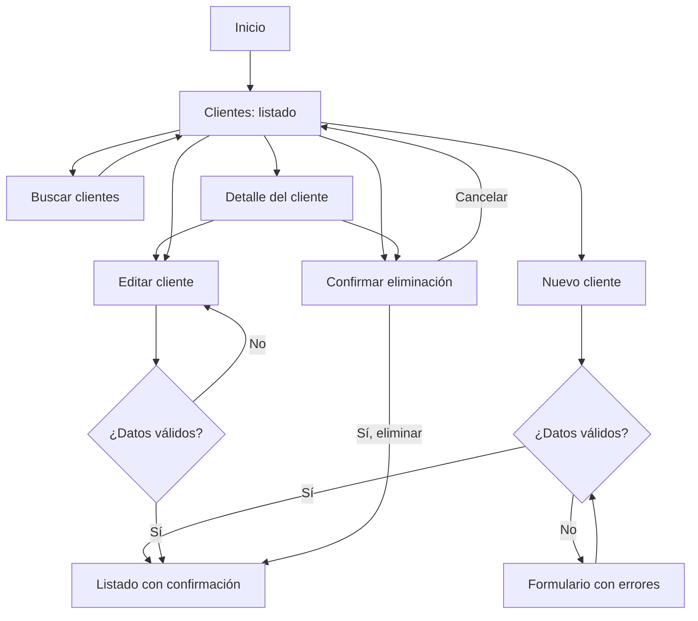

# UX — Módulo de clientes

**Proyecto:** Taller Cardona S.A. — DAS901, Fase 2  
**Módulo:** Clientes  
**Rama:** `modulo/clientes`  
**Prototipo:** [archivo de Figma del grupo](https://www.figma.com/design/Vr8A7l96zkheF8tdUVOI8h) — pantallas Clientes / Lista, Nuevo, Nuevo (errores), Editar, Detalle y Eliminar.

## 1. Propósito y alcance

El módulo centraliza los datos de contacto de los clientes del taller y es la puerta de entrada del sistema: sin un cliente registrado no se puede registrar un vehículo ni abrir una orden de trabajo. El personal puede registrar, buscar, consultar, actualizar y eliminar clientes, y ver desde la ficha de cada uno los vehículos que tiene asociados. Cubre los requerimientos RF-01 y RF-15 del Avance 1.

El sistema se utiliza internamente en el taller. Los clientes aportan sus datos de contacto; el personal del taller es quien opera el sistema. Proveedores no participan en los flujos de este módulo.

## 2. Usuarios y actores

Los actores parten de los usuarios identificados para Taller Cardona en el análisis inicial: clientes, empleados (mecánicos, técnicos y personal del taller) y administración. Se precisan aquí para las tareas del módulo, sin asumir que existan cuentas o permisos por rol en el prototipo.

| Actor | Relación con el módulo | Necesidad |
|---|---|---|
| Encargado del taller o empleado que atiende al cliente | Usuario principal del sistema | Registrar al cliente la primera vez que llega y encontrarlo rápido en las visitas siguientes, sin volver a pedirle sus datos |
| Mecánico o técnico | Usuario interno de consulta | Confirmar a quién pertenece un vehículo y cómo contactarlo para avisarle del diagnóstico |
| Administración | Usuario interno que mantiene los registros | Mantener los datos de contacto correctos para cobros y comunicación con el cliente |
| Cliente | Actor externo al sistema | Proporcionar su nombre, teléfono, correo y dirección, y recibir avisos sobre su vehículo |

**Fuera del alcance de este módulo:** proveedores, inicio de sesión y permisos por rol.

## 3. Historias de usuario

| Código | Historia | Prioridad | Criterios de aceptación |
|---|---|---|---|
| HU-C01 | Como encargado del taller, quiero registrar un cliente nuevo para tener sus datos de contacto disponibles en cada visita. | Alta | Completo nombre, teléfono y correo (obligatorios) y dirección (opcional). Si los datos son válidos, el sistema me regresa al listado con el mensaje “Operación realizada correctamente.” |
| HU-C02 | Como encargado, quiero buscar clientes por nombre o teléfono para encontrar rápidamente el registro que necesito. | Alta | El listado se filtra con lo que escribo en el buscador; si no hay coincidencias se muestra un mensaje y puedo limpiar la búsqueda. |
| HU-C03 | Como encargado o técnico, quiero consultar el detalle de un cliente para ver sus datos y los vehículos que tiene registrados. | Alta | El detalle muestra teléfono, correo y dirección, y una tabla con placa, vehículo, año y kilometraje de cada vehículo del cliente. |
| HU-C04 | Como encargado, quiero actualizar los datos de un cliente para mantener su información vigente. | Alta | El formulario presenta los datos actuales, permite editarlos y valida antes de guardar; al guardar regreso al listado con confirmación. |
| HU-C05 | Como encargado, quiero que el sistema valide los datos al registrar o editar un cliente para evitar información incompleta o incorrecta. | Alta | El nombre es obligatorio, el teléfono debe tener el formato 0000-0000 y el correo debe ser válido. Se señalan los campos con error, se muestra un aviso general y se conservan los datos escritos. |
| HU-C06 | Como encargado, quiero eliminar un cliente registrado por error para mantener confiable la lista. | Media | Antes de eliminar, el sistema muestra una ventana de confirmación con el nombre del cliente. Si cancelo, no se modifica nada. |

## 4. Casos de uso

### CU-C01 — Registrar cliente

- **Actor principal:** encargado del taller.
- **Precondición:** ninguna; es el primer paso para atender a un cliente nuevo.
- **Flujo básico:** abrir Clientes → Nuevo cliente → completar nombre, teléfono, correo y dirección → Guardar → ver confirmación en el listado.
- **Alternativas:** si falta un dato obligatorio o tiene formato incorrecto, el formulario conserva lo escrito, muestra el aviso “Corrija los campos señalados para continuar.” y marca cada campo con su mensaje.

### CU-C02 — Buscar y consultar cliente

- **Actor principal:** encargado del taller o técnico.
- **Precondición:** el cliente está registrado.
- **Flujo básico:** abrir Clientes → buscar por nombre o teléfono → seleccionar Ver → consultar los datos de contacto y sus vehículos.
- **Alternativas:** si no hay coincidencias, se presenta un mensaje; si el cliente no tiene vehículos, la sección de vehículos muestra un mensaje informativo en lugar de una tabla vacía.

### CU-C03 — Actualizar cliente

- **Actor principal:** encargado del taller.
- **Precondición:** el cliente está registrado.
- **Flujo básico:** localizar cliente → Editar (desde el listado o desde el detalle) → modificar campos → Guardar → volver al listado con confirmación.
- **Alternativas:** las validaciones del registro se aplican también al editar.

### CU-C04 — Eliminar cliente

- **Actor principal:** encargado del taller.
- **Precondición:** el cliente está registrado.
- **Flujo básico:** localizar cliente → Eliminar → revisar la ventana de confirmación → Sí, eliminar → volver al listado con confirmación.
- **Alternativas:** si el usuario elige Cancelar, se cierra la ventana y el registro se conserva.

## 5. Flujos de navegación

### Registro

Inicio → Clientes → Nuevo cliente → completar datos → Guardar → validar campos → regresar al listado con el mensaje de confirmación. Si hay errores, el usuario permanece en el formulario, ve el aviso general y corrige los campos señalados.

### Búsqueda y detalle

Inicio → Clientes → buscar por nombre o teléfono → Ver → revisar datos y vehículos del cliente → Volver al listado.

### Edición

Inicio → Clientes → buscar registro → Editar → modificar datos → validar → Guardar y regresar al listado. También se llega a Editar desde el detalle.

### Eliminación

Inicio → Clientes → localizar registro → Eliminar → confirmar en la ventana → regresar al listado. Con Cancelar se vuelve sin cambios.

## 6. Mapa de navegación

El mapa resume los flujos anteriores. Los rectángulos son pantallas y los rombos son decisiones o validaciones del sistema.

## 7. Reglas y estados de interfaz

- El nombre, el teléfono y el correo son obligatorios; la dirección es opcional.
- El teléfono usa el formato 0000-0000 y el correo debe tener un formato válido.
- Las validaciones indican qué corregir sin borrar los demás datos ingresados, y se acompañan de un aviso general en la parte superior.
- Después de guardar o eliminar, el listado muestra el mensaje “Operación realizada correctamente.”
- Una búsqueda sin resultados muestra un mensaje y permite limpiar el filtro.
- La eliminación siempre requiere confirmación en una ventana que muestra el nombre del cliente.
- El detalle del cliente muestra sus vehículos; esa información depende del módulo de Vehículos.
- Los registros actuales se guardan en memoria y se reinician al detener la aplicación.
- Los perfiles identifican actores y necesidades; el prototipo no implementa inicio de sesión ni permisos por rol.
