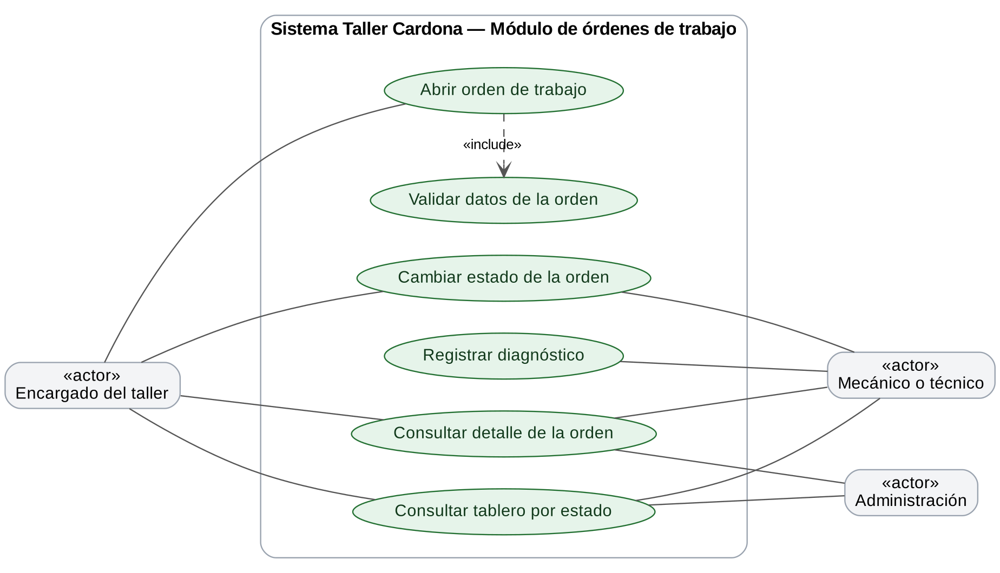
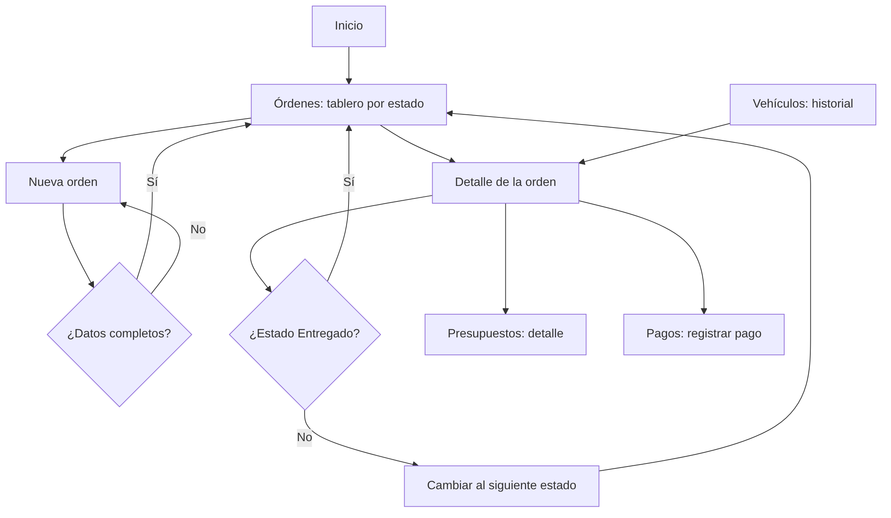

# UX — Módulo de órdenes de trabajo y tablero de estados

**Proyecto:** Taller Cardona S.A. — DAS901, Fase 2  
**Módulo:** Órdenes de trabajo y tablero de estados  
**Rama:** `modulo/ordenes`  
**Prototipo:** [archivo de Figma del grupo](https://www.figma.com/design/Vr8A7l96zkheF8tdUVOI8h) — pantallas Órdenes / Tablero, Nueva orden y Detalle.

## 1. Propósito y alcance

El módulo es el corazón del sistema: registra cada reparación desde que el vehículo entra al taller hasta que se entrega, y muestra en un tablero en qué estado se encuentra cada orden. Resuelve que hoy el estado de una reparación solo lo conoce quien la está atendiendo. Cubre los requerimientos RF-03 y RF-05 del Avance 1.

El sistema se utiliza internamente en el taller. El cliente reporta el problema del vehículo; el personal del taller abre la orden, registra el diagnóstico y avanza su estado. Proveedores no participan en los flujos de este módulo.

## 2. Usuarios y actores

Los actores parten de los usuarios identificados para Taller Cardona en el análisis inicial: clientes, empleados (mecánicos, técnicos y personal del taller) y administración. Se precisan aquí para las tareas del módulo, sin asumir que existan cuentas o permisos por rol en el prototipo.

| Actor | Relación con el módulo | Necesidad |
|---|---|---|
| Encargado del taller o empleado que recibe vehículos | Usuario principal del sistema | Abrir la orden al recibir el vehículo con el problema que reporta el cliente, y marcarla como entregada al devolverlo |
| Mecánico o técnico | Usuario interno que actualiza la orden | Registrar el diagnóstico y avanzar el estado mientras trabaja en el vehículo |
| Administración | Usuario interno de supervisión | Ver de un vistazo cuántas órdenes hay en cada estado y continuar con el presupuesto y el cobro |
| Cliente propietario | Actor externo al sistema | Reportar el problema del vehículo y recibirlo cuando la orden está lista para entrega |

**Fuera del alcance de este módulo:** proveedores, control de inventario, inspección detallada de ingreso (RF-13) y facturación.

## 3. Historias de usuario

| Código | Historia | Prioridad | Criterios de aceptación |
|---|---|---|---|
| HU-O01 | Como encargado del taller, quiero abrir una orden de trabajo asociada a un vehículo para registrar el ingreso y el problema reportado. | Alta | Selecciono un vehículo registrado y completo fecha de ingreso, kilometraje de ingreso y problema reportado; las observaciones son opcionales. La orden se crea con estado “Recibido” y aparece en el tablero. |
| HU-O02 | Como encargado o administración, quiero ver las órdenes en un tablero agrupado por estado para saber en qué va cada reparación. | Alta | El tablero muestra cinco columnas (Recibido, En diagnóstico, En reparación, Listo para entrega y Entregado) con la cantidad de órdenes de cada una. Cada tarjeta muestra número de orden, vehículo, placa, cliente y problema. |
| HU-O03 | Como encargado o técnico, quiero consultar el detalle de una orden para conocer el vehículo, el problema y el diagnóstico. | Alta | El detalle muestra vehículo y placa, cliente, kilometraje de ingreso, problema reportado, diagnóstico y el avance de estados con el estado actual resaltado. |
| HU-O04 | Como técnico, quiero registrar el diagnóstico de una orden para dejar constancia de lo que encontré en el vehículo. | Alta | El diagnóstico queda guardado en la orden y se muestra en su detalle y en el historial del vehículo. |
| HU-O05 | Como técnico o encargado, quiero cambiar el estado de una orden para que todos sepan en qué etapa está. | Alta | Desde el detalle, el botón avanza la orden al siguiente estado; el tablero refleja el cambio. Los estados avanzan en orden y “Entregado” es el estado final. |
| HU-O06 | Como encargado, quiero que el sistema valide los datos al abrir una orden para evitar órdenes incompletas. | Alta | El vehículo, la fecha de ingreso, el kilometraje y el problema reportado son obligatorios; el kilometraje debe ser un número mayor o igual a cero. Se señalan los campos con error sin borrar lo escrito. |
| HU-O07 | Como encargado, quiero pasar desde una orden a su presupuesto o a su pago para no tener que buscarla de nuevo en otro módulo. | Media | El detalle de la orden tiene los botones “Crear presupuesto” y “Registrar pago”, que abren esos módulos con la orden ya identificada. |

## 4. Casos de uso

El diagrama muestra qué actor participa en cada caso de uso del módulo; debajo se describe cada uno.

### CU-O01 — Abrir orden de trabajo

- **Actor principal:** encargado del taller.
- **Precondición:** el vehículo y su propietario están registrados.
- **Flujo básico:** abrir Órdenes de trabajo → Nueva orden → seleccionar vehículo → completar fecha, kilometraje y problema reportado → Guardar orden → ver la orden en la columna “Recibido” del tablero.
- **Alternativas:** si falta un dato obligatorio, el formulario conserva lo escrito y señala el campo; si el vehículo no está registrado, primero se registra en el módulo de Vehículos.

### CU-O02 — Consultar tablero y detalle

- **Actor principal:** encargado del taller, técnico o administración.
- **Precondición:** existe al menos una orden registrada.
- **Flujo básico:** abrir Órdenes de trabajo → revisar el tablero por estado → seleccionar una tarjeta → consultar el detalle de la orden.
- **Alternativas:** si una columna no tiene órdenes, se muestra vacía con su contador en cero; también se llega al detalle desde el historial del vehículo.

### CU-O03 — Cambiar estado de la orden

- **Actor principal:** técnico o encargado del taller.
- **Precondición:** la orden existe y no está en estado “Entregado”.
- **Flujo básico:** abrir el detalle de la orden → Cambiar estado → la orden pasa al siguiente estado → volver al tablero y verla en la nueva columna.
- **Alternativas:** si la orden ya está “Entregado”, no se ofrece cambiar de estado.

### CU-O04 — Registrar diagnóstico

- **Actor principal:** técnico o mecánico.
- **Precondición:** la orden existe.
- **Flujo básico:** abrir el detalle de la orden → registrar el diagnóstico → guardar → el diagnóstico queda visible en el detalle.
- **Alternativas:** el diagnóstico puede actualizarse mientras la orden no esté entregada.

## 5. Flujos de navegación

### Apertura

Inicio → Órdenes de trabajo → Nueva orden → seleccionar vehículo → completar datos → Guardar orden → regresar al tablero con la orden en “Recibido”. Si hay errores, el usuario permanece en el formulario y corrige los campos señalados.

### Consulta

Inicio → Órdenes de trabajo → tablero → seleccionar tarjeta → revisar detalle → Volver al tablero.

### Cambio de estado

Inicio → Órdenes de trabajo → seleccionar tarjeta → Cambiar estado → regresar al tablero con la orden en la siguiente columna.

### Continuación

Detalle de la orden → Crear presupuesto (módulo de Presupuestos) o Registrar pago (módulo de Pagos).

## 6. Mapa de navegación

El mapa resume los flujos anteriores. Los rectángulos son pantallas y los rombos son decisiones o validaciones del sistema.

## 7. Reglas y estados de interfaz

- Toda orden pertenece a un vehículo registrado y se crea con estado “Recibido”.
- Los estados avanzan en este orden: Recibido, En diagnóstico, En reparación, Listo para entrega y Entregado. “Entregado” es el estado final.
- Cada estado tiene un color en el tablero, pero siempre se acompaña de su nombre para no depender solo del color.
- El tablero muestra la cantidad de órdenes de cada columna; una columna sin órdenes se muestra vacía con contador en cero.
- El vehículo, la fecha de ingreso, el kilometraje y el problema reportado son obligatorios; las validaciones no borran los datos ingresados.
- El historial del vehículo se arma con las órdenes de este módulo, por lo que Vehículos depende de él.
- Los registros actuales se guardan en memoria y se reinician al detener la aplicación.
- Los perfiles identifican actores y necesidades; el prototipo no implementa inicio de sesión ni permisos por rol.
