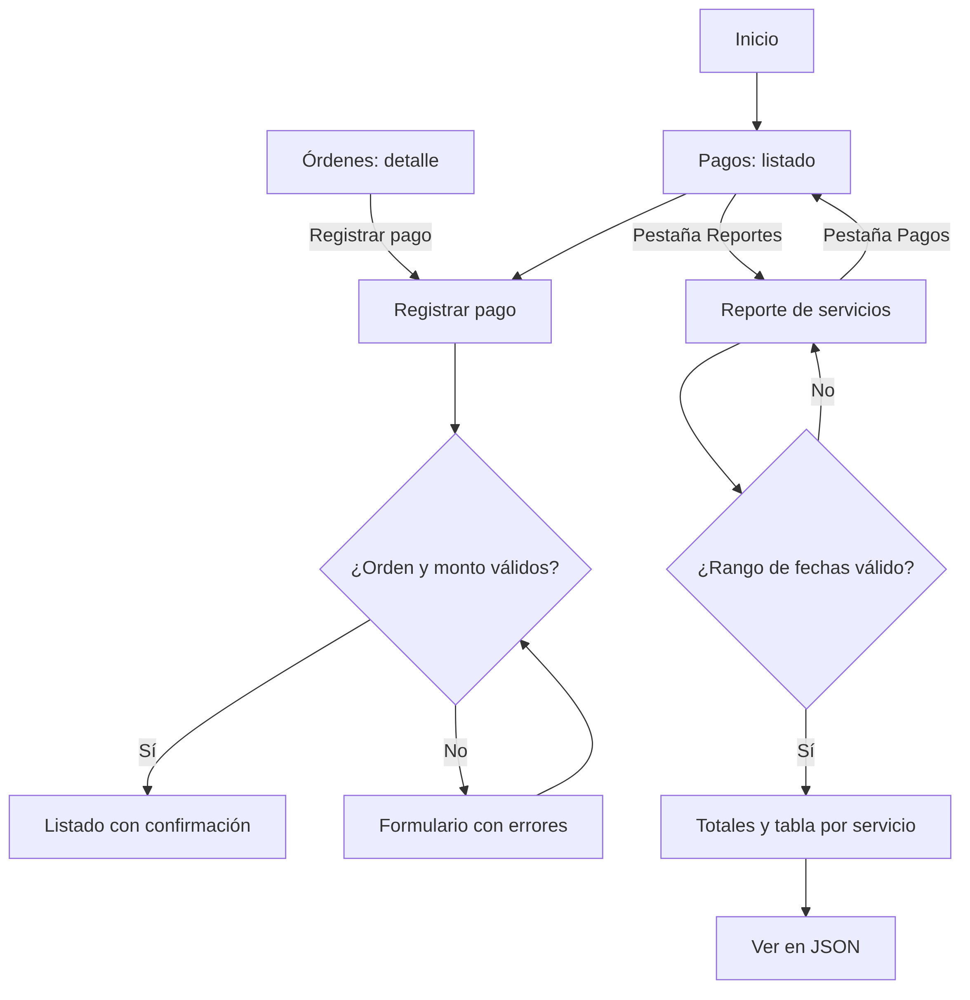

# UX — Módulo de pagos y reportes

**Proyecto:** Taller Cardona S.A. — DAS901, Fase 2  
**Módulo:** Pagos y reportes  
**Rama:** `modulo/pagos`  
**Prototipo:** [archivo de Figma del grupo](https://www.figma.com/design/Vr8A7l96zkheF8tdUVOI8h) — pantallas Pagos / Lista, Lista (éxito), Registrar, Registrar (error) y Reportes / Servicios por fecha.

## 1. Propósito y alcance

El módulo registra los cobros de cada orden de trabajo (fecha, monto y método de pago) y genera un reporte de los servicios realizados en un rango de fechas, algo que hoy el taller tendría que reunir a mano. El reporte también puede obtenerse en formato JSON. Cubre los requerimientos RF-10 y RF-11 del Avance 1.

El sistema se utiliza internamente en el taller. El cliente realiza el pago; el personal del taller lo registra y la administración consulta los reportes. Proveedores no participan en los flujos de este módulo.

## 2. Usuarios y actores

Los actores parten de los usuarios identificados para Taller Cardona en el análisis inicial: clientes, empleados (mecánicos, técnicos y personal del taller) y administración. Se precisan aquí para las tareas del módulo, sin asumir que existan cuentas o permisos por rol en el prototipo.

| Actor | Relación con el módulo | Necesidad |
|---|---|---|
| Encargado del taller o persona que cobra | Usuario principal del sistema | Registrar el pago de una orden en el momento en que el cliente paga, sin errores en el monto |
| Administración | Usuario interno de consulta | Consultar los pagos registrados y saber qué servicios se hicieron y cuánto se cobró en un periodo |
| Mecánico o técnico | Usuario interno ocasional | Consultar si una orden ya fue pagada antes de entregar el vehículo |
| Cliente propietario | Actor externo al sistema | Pagar el servicio con el método que prefiera (efectivo, tarjeta o transferencia) |

**Fuera del alcance de este módulo:** proveedores, facturación electrónica (RF-16), pasarelas de pago en línea y contabilidad.

## 3. Historias de usuario

| Código | Historia | Prioridad | Criterios de aceptación |
|---|---|---|---|
| HU-R01 | Como encargado del taller, quiero registrar el pago de una orden para llevar el control de lo cobrado. | Alta | Selecciono la orden y completo fecha, monto y método de pago (Efectivo, Tarjeta o Transferencia). Si los datos son válidos, regreso al listado con el mensaje “Pago registrado correctamente.” |
| HU-R02 | Como encargado, quiero que el sistema valide los datos del pago para evitar cobros mal registrados. | Alta | La orden es obligatoria y el monto debe ser mayor que cero. Se muestra un aviso general, se señalan los campos con error y se conservan los datos escritos. |
| HU-R03 | Como administración, quiero consultar los pagos registrados para saber qué órdenes están pagadas. | Alta | El listado muestra orden, fecha, cliente, monto, método y estado del pago (“Pagado” o “Anticipo”). |
| HU-R04 | Como administración, quiero generar un reporte de servicios en un rango de fechas para conocer el trabajo realizado en un periodo. | Alta | Indico fecha desde y fecha hasta; el reporte muestra la cantidad total de servicios, el total cobrado y una tabla con cada servicio, su cantidad y su total. |
| HU-R05 | Como administración, quiero obtener el reporte en formato JSON para poder usar los datos en otras herramientas. | Media | El botón “Ver en JSON” devuelve los mismos datos del reporte en formato JSON. |
| HU-R06 | Como administración, quiero que el sistema valide el rango de fechas para no obtener reportes incorrectos. | Media | La fecha desde no puede ser posterior a la fecha hasta; si no hay servicios en el rango, se informa con un mensaje. |

## 4. Casos de uso

### CU-R01 — Registrar pago

- **Actor principal:** encargado del taller.
- **Precondición:** existe la orden de trabajo.
- **Flujo básico:** abrir Pagos y reportes → Registrar pago (o, desde el detalle de la orden, Registrar pago) → seleccionar orden → completar fecha, monto y método → Guardar pago → ver confirmación en el listado.
- **Alternativas:** si falta la orden o el monto es cero, el formulario conserva lo escrito, muestra el aviso “Corrija los campos señalados para continuar.” y marca cada campo con su mensaje.

### CU-R02 — Consultar pagos

- **Actor principal:** administración o encargado del taller.
- **Precondición:** existe al menos un pago registrado.
- **Flujo básico:** abrir Pagos y reportes → revisar el listado de pagos con su estado.
- **Alternativas:** si no hay pagos registrados, se muestra un mensaje informativo en lugar de una tabla vacía.

### CU-R03 — Generar reporte de servicios

- **Actor principal:** administración.
- **Precondición:** existen órdenes con servicios realizados.
- **Flujo básico:** abrir Pagos y reportes → pestaña Reportes → indicar fecha desde y hasta → Generar reporte → revisar totales y tabla por servicio.
- **Alternativas:** si el rango no es válido, se señala el error; si no hay servicios en el rango, se informa con un mensaje; con “Ver en JSON” se obtienen los mismos datos en formato JSON.

## 5. Flujos de navegación

### Registro de pago

Inicio → Pagos y reportes → Registrar pago → seleccionar orden → completar datos → Guardar pago → validar → regresar al listado con confirmación. Si hay errores, el usuario permanece en el formulario y corrige los campos señalados.

### Pago desde la orden

Órdenes de trabajo → Detalle de la orden → Registrar pago → completar datos → Guardar pago → listado de pagos.

### Consulta de pagos

Inicio → Pagos y reportes → revisar listado y estados.

### Reporte

Inicio → Pagos y reportes → pestaña Reportes → indicar rango de fechas → Generar reporte → revisar resultados → opcionalmente Ver en JSON. Con la pestaña Pagos se vuelve al listado.

## 6. Mapa de navegación

El mapa resume los flujos anteriores. Los rectángulos son pantallas y los rombos son decisiones o validaciones del sistema.

## 7. Reglas y estados de interfaz

- Todo pago pertenece a una orden de trabajo registrada.
- El monto se maneja en dólares con dos decimales y debe ser mayor que cero.
- Los métodos de pago son fijos: Efectivo, Tarjeta y Transferencia.
- Un pago se muestra como “Anticipo” cuando lo pagado no cubre el total de la orden, y como “Pagado” cuando lo cubre.
- Las validaciones indican qué corregir sin borrar los demás datos ingresados, y se acompañan de un aviso general.
- Las fechas del reporte viajan en la dirección (URL), de modo que el mismo reporte se puede volver a abrir con el mismo filtro.
- El reporte en JSON contiene los mismos datos que la vista del reporte.
- El módulo depende de Órdenes de trabajo, de donde toma la orden, el cliente y los servicios realizados.
- Los registros actuales se guardan en memoria y se reinician al detener la aplicación.
- Los perfiles identifican actores y necesidades; el prototipo no implementa inicio de sesión ni permisos por rol.
