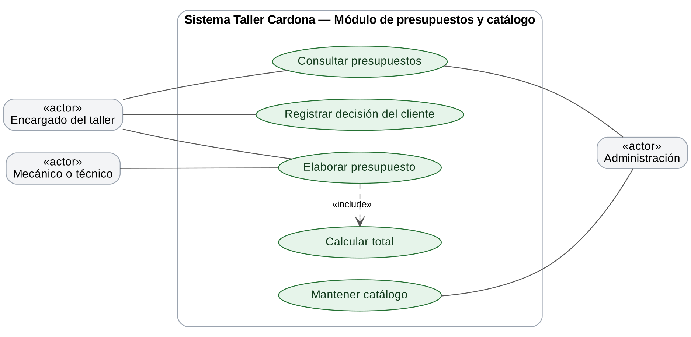
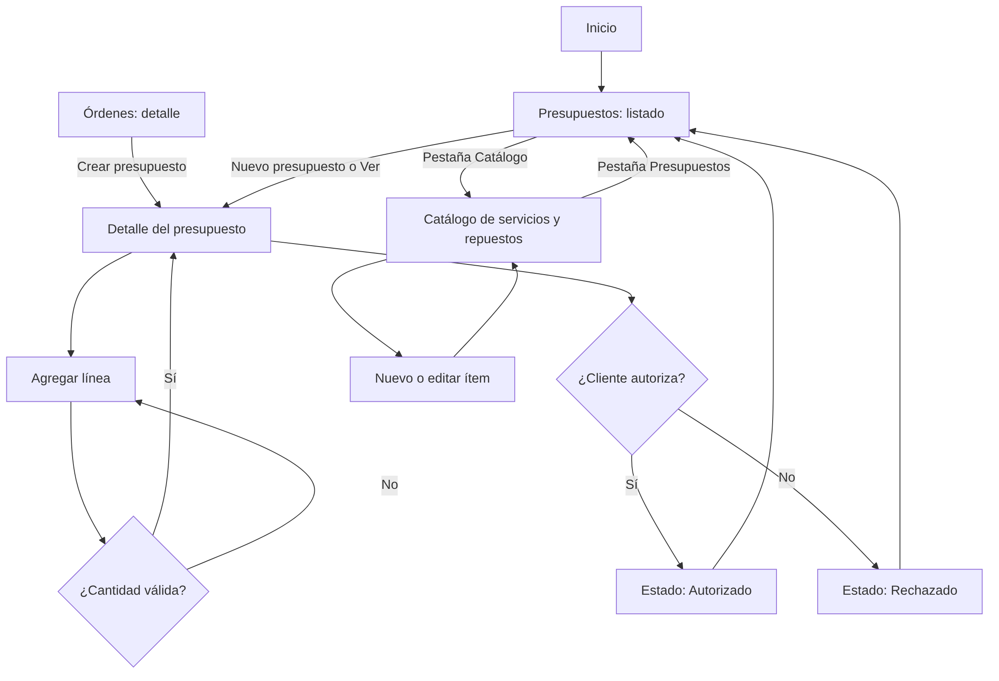

# UX — Módulo de presupuestos y catálogo

**Proyecto:** Taller Cardona S.A. — DAS901, Fase 2  
**Módulo:** Presupuestos y catálogo  
**Rama:** `modulo/presupuestos`  
**Prototipo:** [archivo de Figma del grupo](https://www.figma.com/design/Vr8A7l96zkheF8tdUVOI8h) — pantallas Presupuestos / Lista, Presupuestos / Detalle y Catálogo / Servicios y repuestos.

## 1. Propósito y alcance

El módulo deja constancia de lo que se cotizó para cada orden de trabajo y de si el cliente lo autorizó antes de empezar la reparación. Incluye un catálogo de servicios y repuestos con sus precios, para armar los presupuestos sin escribir todo cada vez, y calcula el total de forma automática. Cubre los requerimientos RF-06, RF-07 y RF-12 del Avance 1.

El sistema se utiliza internamente en el taller. El cliente autoriza o rechaza el presupuesto; el personal del taller lo elabora y registra la decisión. Proveedores no participan en los flujos de este módulo.

## 2. Usuarios y actores

Los actores parten de los usuarios identificados para Taller Cardona en el análisis inicial: clientes, empleados (mecánicos, técnicos y personal del taller) y administración. Se precisan aquí para las tareas del módulo, sin asumir que existan cuentas o permisos por rol en el prototipo.

| Actor | Relación con el módulo | Necesidad |
|---|---|---|
| Encargado del taller | Usuario principal del sistema | Armar el presupuesto de una orden, explicárselo al cliente y registrar si lo autoriza o lo rechaza |
| Mecánico o técnico | Usuario interno que aporta el detalle | Indicar los servicios y repuestos necesarios según el diagnóstico de la orden |
| Administración | Usuario interno que mantiene el catálogo | Mantener actualizados los servicios, repuestos y precios del catálogo |
| Cliente propietario | Actor externo al sistema | Conocer el costo estimado antes de la reparación y autorizarlo o rechazarlo |

**Fuera del alcance de este módulo:** proveedores, control de inventario y stock (RF-14), compras de repuestos y facturación.

## 3. Historias de usuario

| Código | Historia | Prioridad | Criterios de aceptación |
|---|---|---|---|
| HU-P01 | Como encargado del taller, quiero crear un presupuesto para una orden de trabajo para informar al cliente el costo estimado. | Alta | El presupuesto queda asociado a una orden y se crea con estado “Pendiente”. Agrego líneas de servicios o repuestos del catálogo indicando la cantidad. |
| HU-P02 | Como encargado, quiero que el sistema calcule el total automáticamente para evitar errores de suma. | Alta | Cada línea muestra subtotal = cantidad × precio y el total es la suma de los subtotales; se actualiza al agregar o quitar una línea. |
| HU-P03 | Como encargado, quiero registrar si el cliente autoriza o rechaza el presupuesto para tener respaldo antes de iniciar la reparación. | Alta | El detalle tiene los botones “Autorizar” y “Rechazar”; el estado cambia a “Autorizado” o “Rechazado” y regreso al listado. |
| HU-P04 | Como encargado o administración, quiero consultar el listado de presupuestos para ver cuáles están pendientes. | Alta | El listado muestra número, orden, cliente, fecha, total y estado de cada presupuesto, con el estado como etiqueta de color y texto. |
| HU-P05 | Como administración, quiero consultar el catálogo de servicios y repuestos para conocer los precios vigentes. | Media | El catálogo muestra el tipo (Servicio o Repuesto), el nombre y el precio de cada ítem. |
| HU-P06 | Como administración, quiero agregar y editar ítems del catálogo para mantener los precios al día. | Media | El nombre, el tipo y el precio son obligatorios; el precio debe ser mayor que cero. |
| HU-P07 | Como encargado, quiero que el sistema valide las líneas del presupuesto para evitar cotizaciones incorrectas. | Media | La cantidad debe ser un número entero mayor o igual a 1, y no se puede autorizar un presupuesto sin líneas. |

## 4. Casos de uso

El diagrama muestra qué actor participa en cada caso de uso del módulo; debajo se describe cada uno.

### CU-P01 — Elaborar presupuesto

- **Actor principal:** encargado del taller.
- **Precondición:** existe la orden de trabajo y el catálogo tiene servicios o repuestos.
- **Flujo básico:** abrir Presupuestos y catálogo → Nuevo presupuesto (o, desde el detalle de la orden, Crear presupuesto) → Agregar línea → elegir ítem y cantidad → revisar el total calculado.
- **Alternativas:** si la cantidad no es válida, la línea no se agrega y se señala el campo; si el ítem no existe en el catálogo, primero se registra en la pestaña Catálogo.

### CU-P02 — Registrar decisión del cliente

- **Actor principal:** encargado del taller.
- **Precondición:** el presupuesto está en estado “Pendiente” y tiene al menos una línea.
- **Flujo básico:** abrir el detalle del presupuesto → Autorizar o Rechazar → volver al listado con el nuevo estado.
- **Alternativas:** si el presupuesto no tiene líneas, no se permite autorizarlo.

### CU-P03 — Consultar presupuestos

- **Actor principal:** encargado del taller o administración.
- **Precondición:** existe al menos un presupuesto.
- **Flujo básico:** abrir Presupuestos y catálogo → revisar el listado → Ver → consultar líneas, total y estado.
- **Alternativas:** si no hay presupuestos, se muestra un mensaje informativo en lugar de una tabla vacía.

### CU-P04 — Mantener catálogo

- **Actor principal:** administración.
- **Precondición:** ninguna.
- **Flujo básico:** abrir Presupuestos y catálogo → pestaña Catálogo → Nuevo ítem o Editar → completar tipo, nombre y precio → guardar → volver al catálogo.
- **Alternativas:** si el precio es cero o falta un dato, el formulario conserva lo escrito y señala el campo.

## 5. Flujos de navegación

### Elaboración

Inicio → Presupuestos y catálogo → Nuevo presupuesto → Agregar línea → elegir ítem y cantidad → revisar total. También se inicia desde Detalle de la orden → Crear presupuesto.

### Autorización

Inicio → Presupuestos y catálogo → Ver presupuesto → Autorizar o Rechazar → regresar al listado con el estado actualizado.

### Consulta

Inicio → Presupuestos y catálogo → revisar listado y estados → Ver → Volver al listado.

### Catálogo

Inicio → Presupuestos y catálogo → pestaña Catálogo → Nuevo ítem o Editar → guardar → regresar al catálogo. Con la pestaña Presupuestos se vuelve al listado.

## 6. Mapa de navegación

El mapa resume los flujos anteriores. Los rectángulos son pantallas y los rombos son decisiones o validaciones del sistema.

## 7. Reglas y estados de interfaz

- Todo presupuesto pertenece a una orden de trabajo y se crea con estado “Pendiente”.
- El total se calcula automáticamente en el modelo: subtotal por línea (cantidad × precio) y total como suma de subtotales.
- Los estados posibles son Pendiente, Autorizado y Rechazado; un presupuesto autorizado o rechazado ya no se modifica.
- No se puede autorizar un presupuesto sin líneas.
- Cada línea indica con una etiqueta si es Servicio o Repuesto.
- Los precios se manejan en dólares con dos decimales y deben ser mayores que cero.
- El presupuesto depende del módulo de Órdenes de trabajo, de donde toma la orden, el vehículo y el cliente.
- Los registros actuales se guardan en memoria y se reinician al detener la aplicación.
- Los perfiles identifican actores y necesidades; el prototipo no implementa inicio de sesión ni permisos por rol.
